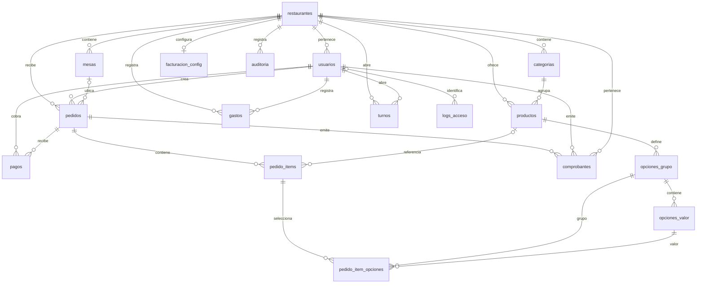

# Base de datos e integridad del dinero

Fecha: 2026-11-09. No se conectó a MySQL/MariaDB. El esquema desplegado no está comprobado; se analizaron 000, 001 y 002. `demo_actual.sql` ya no está en el árbol actual. 000 es un instalador con demo, 001 añade encargado/auditoría, 002 intenta ser un instalador alternativo completo; **no son tres migraciones consecutivas aplicables a una misma base**. 002 tiene el defecto H-018 y no debe usarse sin corrección y ensayo.

## Modelo observado

Las flechas representan FK existentes en 000+001; las de comprobantes faltan en 002. Las relaciones de turno con pagos/gastos/pedidos son conceptuales por fechas, no FK.

Fuente: `Database/000_restaurante_db.sql:844-940`, `001_rol_encargado.sql:10-21`, `002_produccion_limpia.sql:593-687`. Usuarios tiene restaurante nullable para superadmin; una mesa/producto puede quedar NULL en un pedido/ítem tras borrado. Auditoría guarda usuario_id sin FK para conservar el actor textual.

## Restricciones y tipos

- InnoDB/utf8mb4 y DECIMAL son adecuados en las tablas completas. 002 no fija ENGINE/collation para comprobantes y omite pagos_json, created_at, CHECK JSON, PK, UNIQUE y FK; AUTO_INCREMENT sin clave provoca fallo (H-018).
- Mesa única `(restaurante_id, numero)` y turno abierto único por columna virtual ya existen (`002:397-399,466-470`); no agregar índices duplicados. Correlativo único `(restaurante_id,serie,correlativo)` solo consta en 000 (`620-628`), no en el 002 defectuoso.
- Email es único global (`002:475-478`) y login no pide restaurante (`auth/login.php:25-33`): es una decisión coherente con la identidad actual. Cambiar a email único por restaurante exige cambiar login y modelo de identidad; no es una corrección aislada.
- FK simples garantizan existencia, no igualdad de inquilino: producto/categoría o pedido/mesa podrían cruzarse si un escritor salta las validaciones de aplicación. Evaluar claves compuestas solo con prevalidación de datos y coste justificado.
- Dinero DECIMAL(8,2)/(10,2), pero PHP/JS usan float. Evitar acumular fracciones de céntimo o aceptar valores fuera de rango; aplicar céntimos enteros en servidor y validar entradas antes de transacción. Cantidades y montos positivos no están protegidos por CHECK en todas las tablas.
- JSON se usa como snapshot de ítems/pagos del comprobante; conservarlo es útil, pero se guarda el array de pagos sin normalizar (H-023) y la identidad fiscal del emisor se obtiene de configuración viva al imprimir (`roles/admin/ver_comprobante.php:19-30`). Cambiar razón social/dirección cambia la reimpresión antigua. Proponer snapshot del emisor al emitir.
- Hay `activo` en catálogo, usuarios y gastos, pero existen DELETE físicos. Edición de opciones borra referencias históricas; nombre_producto está definido y no se llena al insertar (H-006).
- ENUM de roles, estados y métodos limita errores de dominio; cambios requieren migración. El error concreto es `otros` en el desglose contra `otro` en pagos (H-002), no el uso de ENUM por sí mismo.
- PHP America/Lima y PDO `-05:00` coinciden (`config/db.php:56,70`). SQL usa UTC durante importación, correcto para literales UTC de un dump. No hay prueba de desfase PHP/BD actual. Timestamps enviados al navegador requieren zona explícita: `assets/js/main.js:199-209` parsea sin zona; verificar desde un dispositivo fuera de Perú.

## Reconciliación por pantalla

| Concepto | Origen actual | Caso que lo separa | Regla objetivo |
|---|---|---|---|
| Venta diaria dashboard | pagos no anulados, DATE(pagos.created_at) | apertura ayer/pago hoy | día del cobro |
| Venta diaria reportes | pedidos.total, DATE(pedidos.created_at) | mismo caso | distinguir fecha de apertura de cobro |
| Caja abierta/cierre | pagos de pedidos cobrados, pedidos.updated_at en rango | reapertura/modificación mueve pedido | turno_id del movimiento |
| Histórico cerrado | totales guardados + conteos/gastos vivos | editar gasto y revertir venta | snapshot estable + ajustes posteriores |
| Gastos dashboard/reportes | gastos.fecha | gasto retroactivo | fecha contable etiquetada |
| Gastos de turno | gastos.created_at | carga tardía del gasto | turno de registro y fecha contable separadas |
| Desglose por cajero | pedidos.usuario_id | crea mesero A, cobra B | pagos.usuario_id para cobros |
| Otro en detalle | metodo = otros | pago método otro | mismo valor de dominio |
| Detalle de pedido | todos sus pagos | reabrir y recobrar | separar activos de anulados |
| Historial listado | LEFT JOIN comprobantes sin excluir anulados | reemisión tras reapertura duplica pedido | documento vigente elegido explícitamente |
| Panel global | SUM tras joins usuarios × mesas × pedidos | 2 usuarios × 3 mesas | preagregación por restaurante |

El listado de comprobantes tiene LIMIT 200 y ventas LIMIT 100; totales se calculan por rutas distintas. No interpretar la suma visual de filas como total de todo el período. Los filtros por tipo de comprobante no se aplican igual al resumen (`roles/admin/historial_comprobantes.php:28-29,53-63`): etiquetar o alinear.

## Transacciones y concurrencia

Cobro/emitir/reabrir/cancelar/eliminar bloquean pedido; agregar no lo bloquea y permite ítems posteriores al cobro (H-007). `total = total + ?` es una suma atómica: dos sumas simultáneas por sí solas no demuestran pérdida de incremento. El fallo está en no serializar todo el ciclo del pedido y en recalcular de formas diferentes. `eliminar_item` recalcula suma de ítems y puede borrar la interpretación de ajustes al reabrir. Adoptar un único cálculo del servidor.

Cobrar busca un turno abierto sin bloquearlo y acepta cobro aunque no haya ninguno (`api/cobrar_pedido.php:90-125`; guardar:201-233). Cerrar no impide pedidos activos y puede crear otro turno con el mismo segundo de frontera. Definir antes de implementar: permitir pendientes entre turnos, turno al que pertenece el cobro y política de reversos. Usar intervalos semiabiertos para consultas históricas si aún se usan fechas. La regla principal debe ser referencia explícita a movimiento/turno, no timestamps.

## Consultas e índices propuestos

| Ruta/fuente | Problema | Candidato condicionado a EXPLAIN |
|---|---|---|
| get_reportes:20-52 / reportes:16-49 | DATE y períodos sin límite | pedidos(restaurante_id,estado,created_at) si mide aperturas; nueva fecha cobro si mide caja |
| caja:26-33 / cerrar_turno:43-53 | updated_at mutable | reemplazar por relación turno; índice transitorio no resuelve integridad |
| get_pedidos_activos:16-54 | subconsulta MAX/EXISTS por pedido | pedidos(restaurante_id,estado); pedido_items(pedido_id,estado,created_at) |
| get_opciones:33-36 | una consulta por grupo | cargar valores de todos los grupos en una consulta si medición lo requiere |
| gastos/turno_detalle | created_at, no índice correspondiente | gastos(restaurante_id,created_at), manteniendo índice fecha contable |
| logs recientes | ORDER BY created_at sin política retención | índice created_at,id y archivo con acceso restringido |
| historial de comprobantes | filtros inquilino/tipo/fecha | primero reparar DDL, luego EXPLAIN con filtros reales |

No se ejecutó EXPLAIN y no se garantizan mejoras numéricas. En MariaDB algunas versiones optimizan expresiones DATE; comprobar motor y plan antes de calificar full scan. Medir p95, filas examinadas y tamaños, no instalar todos los índices por intuición.

## Crecimiento: escenario explícito, no tráfico medido

Supuestos: 150 pedidos/día, 30 días/mes, 3 ítems/pedido, 1,2 pagos/pedido, 6 eventos de auditoría/pedido, 10 accesos y 10 gastos/día, 2 turnos/día y comprobante en 50 % de pedidos. Filas por mes/restaurante: pedidos 4.500, ítems 13.500, pagos 5.400, auditoría 27.000, logs 300, gastos 300, turnos 60, comprobantes 2.250. Opciones dependen del menú: con un valor por ítem se suman 13.500/mes. Reversos/anulados pueden elevar pagos y comprobantes.

| Restaurantes | Pedidos/año | Ítems/año | Pagos/año | Auditoría/año | Comprobantes/año |
|---|---:|---:|---:|---:|---:|
| 1 | 54.000 | 162.000 | 64.800 | 324.000 | 27.000 |
| 10 | 540.000 | 1.620.000 | 648.000 | 3.240.000 | 270.000 |
| 50 | 2.700.000 | 8.100.000 | 3.240.000 | 16.200.000 | 1.350.000 |
| 200 | 10.800.000 | 32.400.000 | 12.960.000 | 64.800.000 | 5.400.000 |

Logs anuales = 3.600 × N; gastos = 3.600 × N; turnos = 720 × N. Medir tamaño real de JSON/texto/índices con una copia antes de proyectar GB. Propuesta operativa inicial: auditoría reciente consultable 90 días y archivo privado; logs de acceso 30–90 días según necesidad. Son valores para acordar con responsable de datos/asesor, no plazos legales. No purgar contabilidad ni comprobantes por esta sugerencia.

## Estrategia por etapa

| Estrategia | Ventaja | Coste/riesgo | Uso recomendado |
|---|---|---|---|
| Instancia y BD por restaurante | corte de datos claro; coincide operación actual | desplegar y respaldar N veces; deriva de versiones | mantener durante remediación, automatizar empaquetado seguro |
| Código compartido, BD por restaurante | aislamiento físico de datos, versión común | resolución de tenant/conexiones y N migraciones; evitar BD elegida por entrada libre | evaluar si aislamiento pesa más que analítica global |
| BD compartida con restaurante_id | alta y reportes centralizados | cualquier bypass lógico puede afectar a todos; backups/restores por tenant difíciles | solo tras checklist y pruebas; pools pequeños medidos antes de crecer |

No hay número mágico de restaurantes seguro. Con el escenario de polling de 04, diez en una cuenta exceden cuota documentada incluso antes de transacciones. Seguridad bloquea hoy el segundo; capacidad debe medirse por cuenta, no solo por base. Para 50/200, hosting y respaldos dedicados a esa carga, carga sintética y aislamiento comprobado antes de consolidar.

## Migraciones y consolidación

1. Identificar por instancia versión, motor, esquema y fecha de corte. Ensayar restauración privada; nunca partir de 002 sin reparar.
2. Definir registro de migraciones: número único, nombre, checksum, fecha y operador. No ejecutar DDL al arrancar PHP. Separar instalador vacío de migraciones incrementales y demo.
3. Crear staging con esquema destino validado. Para cada origen mapear ids de restaurantes, usuarios, mesas, categorías, productos, opciones, turnos, pedidos, ítems, pagos y comprobantes en tablas de correspondencia. Mantener ids externos si se usan en impresión/soporte.
4. Resolver colisiones de email global sin fusionar personas automáticamente. Preservar hashes solo dentro de canales privados. Definir nuevos correlativos/series por restaurante, nunca renumerar documentos emitidos.
5. Importar según FK con mapeo en todos los hijos y JSON que contenga ids. Validar huérfanos, pertenencia, conteos, sumas por método/día y anulaciones; conservar snapshots e históricos.
6. Ejecutar pruebas A/B por rol, comparar cierres con exportaciones anteriores. Congelar escrituras para corte final, repetir el ensayo y documentar diferencias. Si no hay ventana de congelación, diseñar sincronización explícita antes de prometer consolidación.
7. Activar un piloto; monitorear y mantener originales en solo lectura. Reversa: detener escrituras del destino y volver a instancia origen en corte conocido, con reconciliación manual de movimientos nuevos. Nunca restaurar una copia antigua encima de ventas nuevas sin plan.

## Backup y restauración dentro del hosting actual

Responsable designado exporta manualmente con phpMyAdmin estructura+datos antes de cada despliegue y al final de jornada; si perder un día de caja no es aceptable, aumentar frecuencia o cambiar a hosting con respaldos programados. Guardar copias cifradas fuera de web/hosting con acceso limitado y retención acordada. Copiar logos y configuración por canal privado, sin publicarlos en Git. Una exportación no es una prueba de recuperación.

Ensayo mensual y tras cambios estructurales: importar manualmente en base aislada, registrar duración, verificar FKs/conteos/totales, iniciar aplicación con configuración de ensayo y pasar cobro/caja/aislamiento. Registrar RPO (ventas máximas que se podrían perder) y RTO (tiempo máximo de recuperación) acordados; no hay medición actual. No se asume cron/shell en InfinityFree.
